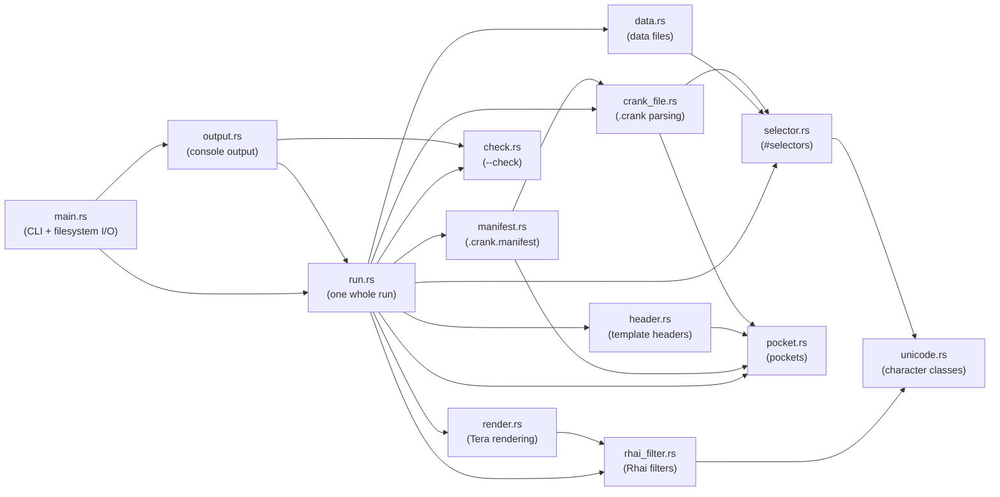
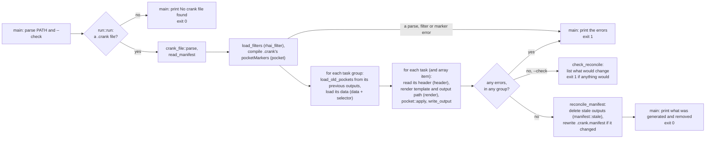

# Architecture

crank is a small Rust binary with the actual logic factored into a
library crate: [`src/main.rs`](../src/main.rs) is the only part that
touches the filesystem or the process exit code, and every other module
is pure — string/data in, string/data out. Even a whole run, from
reading `.crank` to deleting stale outputs, lives in the library
([`run.rs`](../src/run.rs)), reaching files only through a small trait
that `main.rs` implements over the real disk (see
[`AGENTS.md`](../AGENTS.md)'s "Code shape" section for the convention
this follows). This page is about how those pieces fit together; see
[`features.md`](features.md) and [`crank-file-format.md`](crank-file-format.md)
for what crank actually does from a user's point of view.

## Module responsibilities

| Module | Responsibility |
|---|---|
| [`main.rs`](../src/main.rs) | CLI entry point (via `clap`). The only I/O: implements `run.rs`'s [`Workspace`](../src/run.rs#L31-L65) trait over the real disk (reading, writing and deleting files, creating directories, telling whether two paths are one file — refusing any path that leads outside the directory crank runs in through a symbolic link), calls `run::run`, prints the lines `output::report_lines` makes of the report to stdout/stderr, and sets the exit code. |
| [`lib.rs`](../src/lib.rs) | Crate root — just declares the modules below. |
| [`run.rs`](../src/run.rs) | One whole run: reads `.crank` and `.crank.manifest`, compiles the filters and `.crank`'s pocket markers, runs every task group (loading its data, reading each task's template header, rendering it, carrying pockets over), checks no two outputs are the same file, writes them all, then deletes stale outputs and rewrites the manifest — or, under `--check`, only works out what would change. Returns a [`Report`](../src/run.rs#L137-L163). Reaches files only through `Workspace`; its `MemoryWorkspace` is what the unit tests, the fuzz target, the benchmarks and the playground run crank over. |
| [`crank_file.rs`](../src/crank_file.rs) | Parses `.crank` YAML into a [`CrankFile`](../src/crank_file.rs#L19-L31): task groups, their tasks, custom filters and pocket markers. Checks what serde's derive can't: unique group names, exactly one of `object`/`array`, an `array` task's `output` that varies per item, and an unquoted `{{ ... }}` path. |
| [`selector.rs`](../src/selector.rs) | The `path#selector` syntax of `object:`/`array:`: tokenizes a selector into key and index steps, and resolves it against parsed data, with errors naming the step that failed. |
| [`data.rs`](../src/data.rs) | Parses a data file's YAML, and turns the selected value into a Tera context (or an `array` group's list of items), adding the reserved `crank` variable. |
| [`render.rs`](../src/render.rs) | Renders one template against a context with Tera, registering crank's filters first and refusing any whose name collides with one of Tera's own. Walks Tera's error chain so a failure names its real cause. |
| [`rhai_filter.rs`](../src/rhai_filter.rs) | Compiles `.rhai` filter scripts — crank's built-in `snake_case`/`wrap`, embedded with `include_str!`, and a `.crank` file's own — in a sandboxed Rhai engine with fixed limits, and calls them from Tera, converting values both ways. |
| [`unicode.rs`](../src/unicode.rs) | Character classes `char` doesn't offer (combining marks), shared by selector parsing and the filter sandbox so both agree on what's part of a word. |
| [`header.rs`](../src/header.rs) | Reads a template's crank header — the `{# crank: ... #}` comment at its start — for the pocket markers it lists. |
| [`pocket.rs`](../src/pocket.rs) | Pocket markers: compiles marker patterns (the built-in pairs, or a template's own) into regexes, scans text for pockets (rejecting unclosed, stray and overlapping markers), collects the hand-written content from a group's previous outputs, and splices it into a fresh render. |
| [`manifest.rs`](../src/manifest.rs) | Parses and serializes `.crank.manifest` (each group's outputs, with the pocket markers any were written with), and works out which previous outputs are now stale. |
| [`check.rs`](../src/check.rs) | `--check`'s classification of one output: would writing it create, modify or leave the file unchanged. |
| [`output.rs`](../src/output.rs) | Turns a `run::Report` into crank's plain-text console output — a list of lines, each tagged stdout or stderr, rather than printing them, so the browser playground shows exactly what the CLI prints. |

## Module dependencies

An arrow points from a module to one it depends on.

`unicode.rs`, `pocket.rs` and `check.rs` are the leaves: none depends on
anything else in the crate. The graph has no cycles. `run.rs` is the
only module that knows how the others fit together; each of the rest
does one job on data it's handed — parsing `.crank` doesn't load any
data, rendering doesn't know about pockets, and pockets don't know
where their text came from. `main.rs` sees only `run.rs`'s `Workspace`
and `Report`, and `output.rs`.

## Request flow

`main.rs`'s `main` function parses the command line and hands
`run::run` the directory to run in; everything from reading `.crank` to
rewriting the manifest happens in `run.rs`, roughly:

A failure in one task group or task is collected rather than stopping
the run, so every other group and task still runs; the manifest is only
rewritten, and stale outputs only deleted, when nothing failed.

## The browser playground

The [playground](../playground/README.md) is a separate crate, in
`playground/`, that compiles to WebAssembly. It never touches the disk:
it puts the page's files in a `run::MemoryWorkspace`, runs the same
`run::run` and `output::report_lines` as `main.rs`, and sends back what
crank printed and every file it wrote or deleted, so it shows exactly
what the CLI would. Nothing in `src/` knows the playground exists.

## Test coverage

Per [`AGENTS.md`](../AGENTS.md)'s testing split: unit tests exercise each
module's pure logic directly, and `run.rs`'s whole runs over a
`MemoryWorkspace`; end-to-end tests (`e2e/tests/*.robot`, Robot
Framework) exercise the compiled binary as a black box, so they cover
`main.rs`'s disk access too — the one part with no unit tests of its
own. The playground's examples (`playground/examples/*.md`) are a third
suite: each one is a small project and exactly what crank prints and
generates for it, which `just test` checks.

| Module | Unit tests cover | End-to-end tests covering the same behavior |
|---|---|---|
| `crank_file.rs` | Task groups, tasks, filters, pocket markers, every parse error | `basic.robot`, `errors.robot`, `array.robot` |
| `selector.rs` | Tokenizing, resolving keys and indexes, every syntax and resolution error, non-ASCII keys | `object_selectors.robot`, `array.robot`, `unicode.robot` |
| `data.rs` | Parsing data, building a context, an `array` group's items, the reserved `crank` variable | `basic.robot`, `array.robot`, `crank_variable.robot` |
| `render.rs` | Substitution, loops, built-in and custom filters, a filter colliding with Tera's, error chains | `templates.robot`, `filters.robot`, `errors.robot` |
| `rhai_filter.rs` | Compiling filters, both calling conventions, sandbox limits, value conversion | `filters.robot` |
| `header.rs` | Finding and parsing a template's header, every header error | `pocket.robot` |
| `pocket.rs` | The built-in markers, compiling a template's own, carrying content over, every marker error | `pocket.robot` |
| `manifest.rs` | Parsing and serializing, entries with pocket markers, stale outputs | `manifest.robot` |
| `check.rs` | Classifying a write | `check.robot` |
| `run.rs` | Whole runs over a `MemoryWorkspace`: outputs and manifest, stale outputs, `--check`, files that can't be read, written or deleted | Every `e2e/tests/*.robot` file, since every CLI run goes through `run::run` |
| `output.rs` | Every kind of report, singular and plural | Every e2e test's `stdout`/`stderr` assertions |
| `main.rs` | None — it's the I/O layer, tested black-box instead | `path_argument.robot` (the `PATH` argument), `output.robot`, and every other `e2e/tests/*.robot` file, since they all read and write real files through it |

For the measured numbers — how many lines each suite actually reaches,
per file — run `just coverage`, or see any PR's coverage comment
([`coverage.md`](coverage.md)). Whether the tests would *notice* each
line changing is what [mutation testing](mutation-testing.md) checks,
weekly.

[`crank-file-format.md`](crank-file-format.md)'s "Examples" table goes a
level deeper: each row links directly to the specific unit test proving
it, by exact line range.

## Benchmark coverage

Both tiers live under `benches/` (see
[`benchmarking.md`](benchmarking.md) for the full rationale and how to
run them locally — both run in CI on PRs that change implementation
code, but aren't part of `just ci`):

- **`benches/logic.rs`** (Tier 1) counts the CPU instructions of
  `crank_file::parse`, `render::render` (with crank's built-in Rhai
  filters), `pocket::apply`, and a whole `run::run` over a
  `MemoryWorkspace` — so every module but `main.rs`, against synthetic
  in-memory data. A PR that raises a count by more than 1% fails its
  check.
- **`benches/e2e.rs`** (Tier 2) times the real compiled binary
  generating 10 / 100 / 1,000 files in a real directory — the only
  benchmark that exercises `main.rs`'s disk access, which Tier 1 can't
  measure at all since it never leaves memory.

`selector.rs`, `manifest.rs` and `output.rs` aren't benchmarked on their
own — they run inside `run_array`, and none of them is where a run's
time goes.

For generated API reference docs (rustdoc) and everything else `just`
wraps, see [`tooling.md`](tooling.md).
